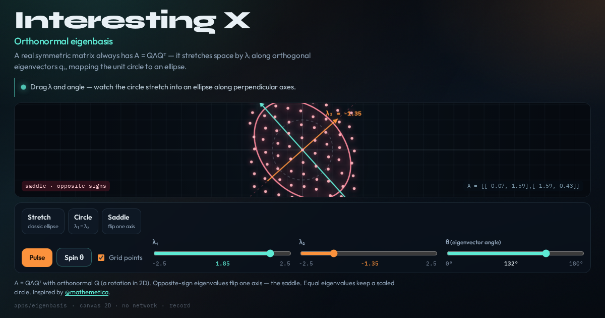

# Orthonormal eigenbasis

A real symmetric matrix stretches the unit circle into an ellipse along perpendicular eigenvectors — drag λ and θ live.



**Live demo:** https://interesting-x.scorpion-labs.com/eigenbasis/

Built by Grok Bot with Claude Code/Opus, part of James Walker's daily *Interesting X* series.

## Run locally

```bash
npm install
npm run dev      # then open the printed URL (served under /eigenbasis/)
npm run build    # static output in dist/
```

## Notes


Interactive 2×2 real-symmetric eigenbasis playground. A = QΛQᵀ stretches the unit circle into an ellipse along orthogonal eigenvectors — live λ and θ controls, particle flow, and a saddle (opposite-sign) wow moment.

## Run

```bash
# from repo root
npm install
npm run dev -w @tech-demos/eigenbasis
# → http://127.0.0.1:43130/eigenbasis/
```

## Record

```bash
npm run record -- eigenbasis --url http://127.0.0.1:8787 --seconds 15
```

Inspired by [@mathemetica](https://x.com/mathemetica/status/2106107952935338378).

## License

MIT © 2026 James Walker
